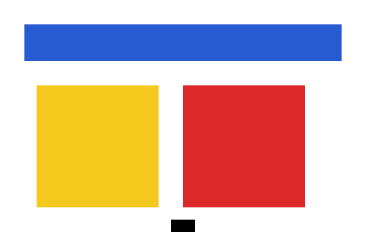

# Math Painting

An app where you give the start coordinates, sizes and colors of squares and rectangles, and it produces an image file with those shapes drawn on a canvas.



## Design

From [`design.txt`](design.txt):

| Object | Attributes | Methods |
|--------|------------|---------|
| `Square` | `x`, `y`, `side`, `color` | `draw(canvas)` |
| `Rectangle` | `x`, `y`, `width`, `height`, `color` | `draw(canvas)` |
| `Canvas` | `width`, `height`, `color` | `make(imagepath)` |

## How it works

The canvas is a grid of pixels held in a NumPy array with one row per `y` and one column per `x`. Each cell holds a color as three numbers: red, green and blue, each from 0 to 255.

```
(0,0) ──────► x
  │   ┌──────────┐
  │   │  (x, y)  │  a shape's (x, y) is its top-left corner
  ▼   │          │
  y   └──────────┘
```

Drawing a shape sets every pixel inside it to the shape's color:

```python
canvas.data[y : y + height, x : x + width] = color
```

- A shape that reaches past the edge of the canvas is cut off at the edge.
- Shapes drawn later cover shapes drawn earlier.
- `Canvas.make` saves the grid as an image with [Pillow](https://pillow.readthedocs.io/). The file type comes from the name you give (`.png`, `.jpg`, ...).

Colors can be typed as a name (`white`, `black`, `red`, `green`, `blue`, `yellow`, `orange`, `purple`, `pink`, `gray`, `brown`, `cyan`) or as three numbers, e.g. `255, 0, 0`.

## Files

| File | Purpose |
|------|---------|
| `canvas.py` | `Canvas` class |
| `shapes.py` | `Square` and `Rectangle` classes |
| `colors.py` | Turns a color name or `R, G, B` into numbers |
| `main.py` | The app: run it from the terminal |
| `tests/` | Tests for the canvas, the shapes, colors and saving |
| `examples/example.png` | The image shown above |

## Run it

Set up once, from this folder:

```bash
python3 -m venv .venv
```

```bash
source .venv/bin/activate
```

```bash
pip install -r requirements.txt
```

Then run the app:

```bash
python main.py
```

It asks for the canvas size and color, then for shapes one at a time. Type `quit` (or press Enter) when you're done, then give a file name. The image is saved to `images/painting.png` unless you choose another name.

Example session (this is how `examples/example.png` was made):

```
Canvas width in pixels: 600
Canvas height in pixels: 400
Canvas color (e.g. white or black): white

What would you like to draw? (square / rectangle / quit): rectangle
x of the top-left corner: 40
y of the top-left corner: 40
Width: 520
Height: 60
Rectangle color: blue

What would you like to draw? (square / rectangle / quit): square
x of the top-left corner: 60
y of the top-left corner: 140
Side length: 200
Square color: yellow
...
What would you like to draw? (square / rectangle / quit): quit

Save the image as (default: images/painting.png): examples/example.png
```

**Tests:**

```bash
pip install pytest
```

```bash
python -m pytest tests
```
